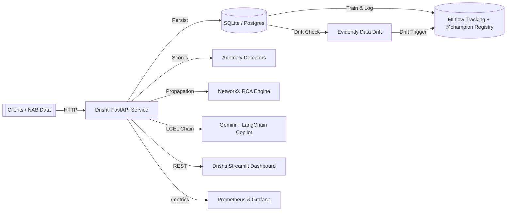

# Drishti — Intelligent MLOps & Observability Platform

**Drishti** is an end-to-end **AIOps + MLOps** platform for real-time anomaly detection, graph-based Root Cause Analysis (RCA), MLflow experiment tracking & model registry (`@champion` alias), Evidently drift-triggered auto-retraining, Prometheus/Grafana observability, and a **LangChain + Gemini** incident explanation copilot.

**Drishti** is an enterprise-grade platform developed for end-to-end MLOps, intelligent observability, and GenAI incident response.

## Architecture



## Syllabus Mapping (Units 1–4)

| Unit | Syllabus Topic | Where It Lives in Drishti |
| :--- | :--- | :--- |
| **Unit 1** | AIOps lifecycle, anomaly detection, RCA | `app/detectors/`, `app/rca/`, `app/viz/dashboard.py` |
| **Unit 2** | Automated data pipelines, MLflow Tracking | `scripts/run_nab_ingest.py`, `scripts/mlflow_tracking.py` |
| **Unit 3** | FastAPI REST serving, Docker, Model Registry, LLM API | `app/main.py`, `app/api.py`, `app/copilot/`, `Dockerfile.*`, `mlflow.db` (`@champion`) |
| **Unit 4** | Drift monitoring, auto-retraining loop, Prometheus/Grafana, CI/CD | `scripts/run_evidently_report.py`, `GET /metrics`, `grafana/`, `.github/workflows/ci.yml` |

## Quickstart (No Docker Required)

```bash
# 1. Create and activate virtual environment
python -m venv .venv
# Windows PowerShell:
.venv\Scripts\Activate.ps1
# macOS / Linux:
# source .venv/bin/activate

# 2. Install core dependencies (skips pmdarima C++ build issues on Windows)
pip install -e .

# 3. Copy .env.example to .env and optionally add your GEMINI_API_KEY
cp .env.example .env

# 4. Run MLflow tracking & register @champion model
python scripts/mlflow_tracking.py

# 5. Start FastAPI backend (Terminal 1)
uvicorn app.main:app --reload --port 8000

# 6. Start Drishti Streamlit dashboard (Terminal 2)
streamlit run app/viz/dashboard.py

# 7. Optional: Launch MLflow UI (Terminal 3)
mlflow ui --backend-store-uri sqlite:///mlflow.db --port 5000
```

## Live Demo Endpoints & Commands

* **Swagger REST API Docs:** `http://localhost:8000/docs`
* **Drishti Streamlit Dashboard:** `http://localhost:8501`
* **MLflow Experiment & `@champion` Registry UI:** `http://localhost:5000`
* **Prometheus Metrics:** `http://localhost:8000/metrics`
* **Trigger Drift Check + Auto-Retrain Demo:**
  ```bash
  python scripts/run_evidently_report.py --service-id ambient_temperature_system_failure --force-retrain
  ```
